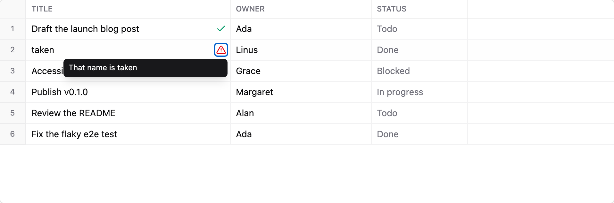

# Sheets

A spreadsheet-style data grid for React, built on [TanStack Table](https://tanstack.com/table/v8). It edits cells in place, saves changes per row, and shows each cell's save status on the cell itself. It started as the Sheets component in Codemancers' Gather.



> **Status:** pre-release. The package isn't on npm yet.

## Packages

| Package                                            | Contents                                                                                               |
| -------------------------------------------------- | ------------------------------------------------------------------------------------------------------ |
| [`@codemancers/sheets`](packages/sheets/README.md) | Headless hooks, Tailwind v4 components and theme tokens. Start with its README: setup, guides and API. |

## Repository layout

| Path                  | Contents                                                                      |
| --------------------- | ----------------------------------------------------------------------------- |
| `packages/sheets`     | The `@codemancers/sheets` package                                             |
| `apps/playground`     | A Vite app with a demo of every feature. The end-to-end tests run against it. |
| `apps/playground-e2e` | Playwright tests, including an axe accessibility scan                         |
| `docs/images`         | Images used by the READMEs                                                    |

## Development

You need Node 24 and pnpm; the pnpm version is pinned in `package.json`.

```sh
pnpm install
pnpm nx dev @codemancers/playground                 # http://localhost:4200
pnpm nx run-many -t lint test build typecheck e2e   # everything CI runs
```

See [CONTRIBUTING.md](CONTRIBUTING.md) for the workflow and conventions.

## License

[MIT](LICENSE)
