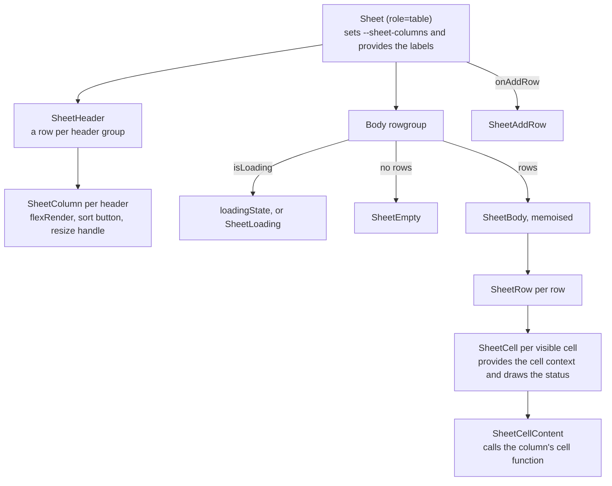
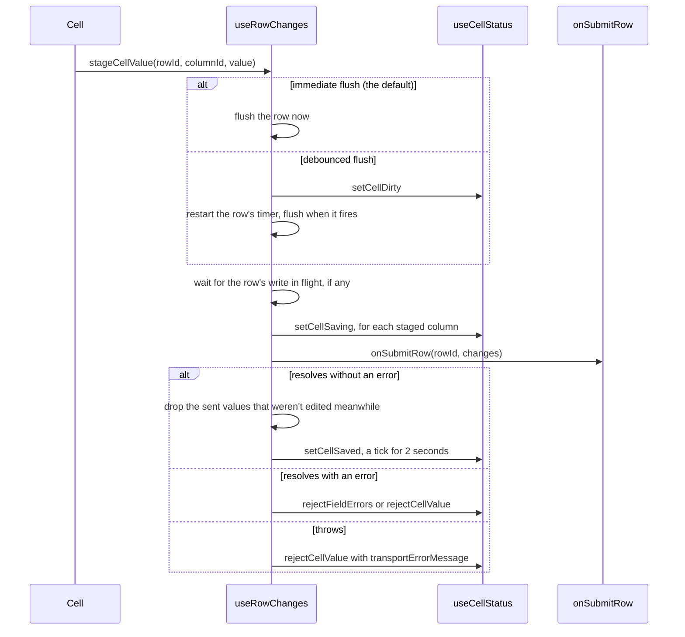

# Architecture

How `@codemancers/sheets` fits together. [decisions.md](decisions.md) explains why it's built this way, and the [package README](../packages/sheets/README.md) documents the API.

## Layers

| Layer    | Source           | Import                           | Contents                                                                                                                                     |
| -------- | ---------------- | -------------------------------- | -------------------------------------------------------------------------------------------------------------------------------------------- |
| Headless | `src/hooks/`     | `@codemancers/sheets`            | TanStack Table with the sheet's defaults, plus the state for editing, saving and opening rows. No JSX, no styles, no imports from `src/ui/`. |
| UI       | `src/ui/`        | `@codemancers/sheets/ui`         | `Sheet` and the cells: React components styled with Tailwind v4 classes                                                                      |
| Styles   | `src/styles.css` | `@codemancers/sheets/styles.css` | Points the app's Tailwind build at the package's source, and declares the colour tokens                                                      |

An app can use the headless layer alone and render its own markup. Everything from [Rendering](#rendering) on describes the UI layer.

## What an app wires together

```tsx
const cellStatus = useCellStatus();
const rowChanges = useRowChanges({
  onSubmitRow,
  cellStatus,
  flush: { debounce: 600 },
});
const drawer = useRowDrawer();
const sheet = useSheet({
  columns,
  data,
  getRowId: (task) => task.id,
  cellStatus,
  rowChanges,
});

return <Sheet instance={sheet} openRowId={drawer.openRowId} />;
```

`useSheet` takes everything `useReactTable` takes, plus `cellStatus` and `rowChanges`. It returns `{ table, cellStatus, rowChanges }`, and `Sheet` renders from that.

`useCellStatus` and `useRowChanges` are separate hooks, not part of `useSheet`, because the columns refer to them: a cell's handlers are written before the table that uses those columns exists. When the app passes no `cellStatus`, `useSheet` creates its own, so cells always have somewhere to report validation and save failures.

## Where state lives

| State                                                                | Lives in                                                                                           | Why there                                                                 |
| -------------------------------------------------------------------- | -------------------------------------------------------------------------------------------------- | ------------------------------------------------------------------------- |
| Sorting, filters, column sizes and the rest of the table state       | TanStack, inside `useSheet`, unless the app controls a piece of it through `state` and `on…Change` | Standard TanStack                                                         |
| Each cell's status (unsaved, saving, saved, error) and refused value | `useCellStatus()`, the app's or `useSheet`'s own                                                   | Above the rows, because rows unmount when the data is sorted or refetched |
| Staged values, debounce timers and the writes in flight              | `useRowChanges()`                                                                                  | The same reason. It also lets several fields go in one write.             |
| The open row                                                         | `useRowDrawer()`, or the app when it passes `openRowId`                                            | The app renders its own drawer                                            |
| The highlighted row                                                  | The app, through `<Sheet highlightedRowId>`                                                        | The app decides when to clear it                                          |
| An editor's draft, and whether it's open                             | `useInlineEdit()`, inside each editable cell                                                       | It only matters while editing                                             |

Statuses, staged values and the open and highlighted rows are all keyed by TanStack's `row.id`. That's the row's index unless the app passes `getRowId`, so pass it whenever rows can move: with sorting, filtering, or data that's refetched.

## Rendering



- **One grid for every row.** The root sets `--sheet-columns` to `40px`, then each visible leaf column's size in pixels, then `1fr`: the row-number column, the data columns, and a spacer that fills the rest. Header, body, empty, loading and add-row rows all lay out on `var(--sheet-columns)` (`src/ui/grid.ts`), so the columns line up without a `<table>`. A group header spans its leaf columns with `grid-column: span n`.
- **Pinned rows.** The body renders TanStack's pinned top rows, then the rest, then the pinned bottom rows, so a pinned row stays put whatever the sort. Apps pin a new row being filled in to the bottom. TanStack memoises the three lists, so the combined one keeps its identity for `SheetBody`'s memo.
- **Resizing re-renders little.** While a column is dragged, only the header and the root's variable change. `SheetBody` skips re-rendering while `columnSizingInfo.isResizingColumn` is set and its other props are unchanged. This is TanStack's advice for `columnResizeMode: 'onChange'`. It depends on `useCellStatus` and `useRowChanges` returning memoised objects.
- **Cells.** `SheetCellContent` calls the column's `cell` function itself, without `flexRender`, so a column array that's rebuilt on every render doesn't remount the cells. A string or number result is wrapped in `SheetTextCell` for its padding. Headers do use `flexRender`.
- **Headers.** The sort button calls TanStack's toggle handler, and shows on hover or keyboard focus. Leaf columns get a resize handle: a focusable separator that takes the mouse, touch, the arrow keys (10 px a step, 50 px with Shift, flipped for `columnResizeDirection: 'rtl'`), and a double-click to reset the width.
- **Text.** `Sheet` merges its `labels` prop over `defaultSheetLabels` and provides them through context, keeping the merged object while the values are the same. Components read them with `useSheetLabels()`.
- **Roles.** The markup is `div`s with ARIA table roles: `table`, `rowgroup`, `row`, `columnheader`, `rowheader` for row numbers, and `cell`. The loading skeleton is hidden from assistive technology, and the body is marked `aria-busy` instead. The open row is `aria-current`, and the highlighted row has `data-highlighted`.

## The cell context

`SheetCell` wraps each cell in `SheetCellProvider` with `{ rowId, columnId, columnLabel, cellStatus, rowChanges }`. A cell reads it with `useSheetCellScope()`, or with `useSheetCellEditing(schema)`, which builds the editing behaviour on top. Apps don't pass ids to cells.

`columnLabel` is the column's header when that's a string, and the column id otherwise. Editors use it as their accessible name.

Outside a `Sheet`, for example in a test, there's no context. The hooks then do nothing: a schema isn't checked, and nothing is staged or reported.

## Editing a cell

`useInlineEdit` runs the editor, and `useSheetCellEditing` connects it to the sheet. Both editable cells, `SheetEditableTextCell` and `SheetPrimaryCell` with `editable`, work like this:

1. **Opening.** Clicking the cell clears its status icon, which would cover the text, but keeps any refused value so a typo can be fixed. The input takes focus as it mounts.
2. **Closing:**
   - Enter or blur commits. Tab moves focus on, and the blur commits.
   - Escape cancels, dropping the cell's staged value, status and refused value.
   - Enter or blur with nothing changed ends the edit the same way, and calls `onCancel` too. That's how an empty new row removes itself.
   - After Enter or Escape, focus returns to the cell.
   - While an IME is composing, Enter belongs to the IME.
3. **Committing** happens when the draft differs from the value shown, or when the value shown isn't saved yet, which is how a refused value is retried:
   - A draft that matches the saved value has nothing to send. As with Escape, the cell drops its staged value, status and refused value.
   - The cell's `schema` runs. If it fails, the cell shows the first issue's message and keeps the value, and nothing is sent.
   - The value is then **staged** in the row buffer if the sheet has one (`useSheet({ rowChanges })`). `SheetPrimaryCell` always stages then, and `SheetEditableTextCell` only with its `stage` prop.
   - Otherwise the cell calls its `onCommit` through `submit`, and the app performs the write. If `onCommit` returns `{ error }`, or throws (shown as the `saveFailed` label), the cell reports it on itself and keeps the value as a refused value, ready for a retry. While an async `onCommit` runs, the cell shows the value being saved.

**What a cell shows:** the value being saved through `onCommit`, otherwise its staged value, otherwise its refused value, otherwise the value from the data. A refetch in the middle of an edit can't overwrite what was typed, and a refused value stays on screen next to its error. `SheetEditableTextCell` only shows a staged value when it has `stage`.

## Saving a row

`useRowChanges` holds the staged values for each row, and sends a row's values together through the app's `onSubmitRow(rowId, changes)`.



- **One write per row at a time.** A flush waits for the row's write in flight, then reads the buffer again, so an edit made in the meantime goes in the next write instead of racing the first.
- **Success** drops only the sent values that weren't edited again during the write, and marks those columns saved.
- **A refusal,** a result with `error`, keeps every staged value, so the user can fix it and retry:
  - Each message in `fieldErrors` goes on the column with the same id, and the other sent columns go back to unsaved, since the whole write was refused.
  - If no sent column gets a message, or one names a field that wasn't sent, `error` goes on every sent column instead.
- **A thrown error** means the request never completed. `transportErrorMessage` goes on every sent column.
- **Unmounting** sends whatever is waiting on a timer, but can't wait for the result. `flushAll()` sends everything at once, for a Save button or a navigation guard, and `hasStagedChanges()` says whether there's anything to send.

How long each status lasts:

| Status  | Set when                                                                       | Cleared when                                                                   |
| ------- | ------------------------------------------------------------------------------ | ------------------------------------------------------------------------------ |
| Unsaved | A value is staged under a debounce, or its write is refused over another field | The write starts                                                               |
| Saving  | The write starts                                                               | The write settles                                                              |
| Saved   | The write succeeds                                                             | After 2 seconds                                                                |
| Error   | A schema fails, or a write is refused or throws                                | The user starts editing the cell or cancels the edit, or a later save succeeds |

With the immediate flush there's no unsaved state: a cell goes from saving to saved or error.

## Opening a row

`useRowDrawer` holds which row is open: the state only, since the app renders its own drawer, side panel or dialog.

- `open(rowId)` remembers the focused element. `close()` clears the open row and then returns focus to that element, if it's still in the page.
- The hook holds the state itself, or the app does when it passes `openRowId`, for example from the URL.
- `<Sheet openRowId>` marks the open row with `aria-current` and a tint. `SheetPrimaryCell`'s `onOpen` is the usual way to open a row.

## Styling

- The components use Tailwind v4 classes. `styles.css` contains `@source './'`, which makes the app's Tailwind build scan the package's source for those classes. That's why the package ships `src/`.
- Colours come from `--color-sheet-*` tokens in a `@theme` block. Dark mode uses separate `-dark` tokens through `dark:` classes, so the app's own dark-mode setup decides when they apply. An app restyles the sheet by redefining the tokens.
- Layout uses logical classes, so the sheet mirrors under `dir="rtl"`. TanStack's `columnResizeDirection: 'rtl'` makes resizing match.

## Build and packaging

- `tsc` compiles `packages/sheets/src` to `dist` as ES modules with type declarations. It uses `nodenext` resolution, which is why relative imports end in `.js`.
- `exports` maps `.` and `./ui` to `dist`, and `./styles.css` to `src/styles.css`.
- Inside the workspace, the custom `@codemancers/source` condition maps the entry points to `src` instead. The playground's Vite config and `customConditions` in `tsconfig.base.json` both use it, so edits to the package reload in the playground without a build. Apps that install the package don't set the condition, so they get `dist`.
- `files` ships `dist` and `src`, without tests. `sideEffects` covers only the CSS.
- The peer dependencies are `react`, `@tanstack/react-table` and, optionally, `tailwindcss`.

## Repository and CI

- **Projects:**

  | Project                       | Tag        | Contents                                                        |
  | ----------------------------- | ---------- | --------------------------------------------------------------- |
  | `@codemancers/sheets`         | `type:lib` | The package                                                     |
  | `@codemancers/playground`     | `type:app` | The demo app                                                    |
  | `@codemancers/playground-e2e` | `type:e2e` | Playwright tests, run against the playground's `preview` target |

  ESLint's `@nx/enforce-module-boundaries` lets apps import libraries, libraries import libraries, and e2e projects depend on apps.

- **Targets** are inferred by Nx plugins from each project's config files:
  - `build` and `typecheck` from `@nx/js/typescript`
  - `dev` and `preview` from `@nx/vite`
  - `test` from `@nx/vitest`
  - `lint` from `@nx/eslint`
  - `e2e` from `@nx/playwright`

  `publint` is declared in the package's `package.json`.

- **CI** (`.github/workflows/ci.yml`) runs on pull requests and on pushes to `main`. It installs with a frozen lockfile, then runs:
  1. `nx sync:check`
  2. `nx format:check`
  3. knip
  4. `nx affected -t lint test build typecheck e2e publint`, against `main`

- **Releases** (`.github/workflows/release.yml`) run when a GitHub release is published. The workflow checks that the tag matches the package version, tests and builds the package, and publishes it to npm through trusted publishing.
