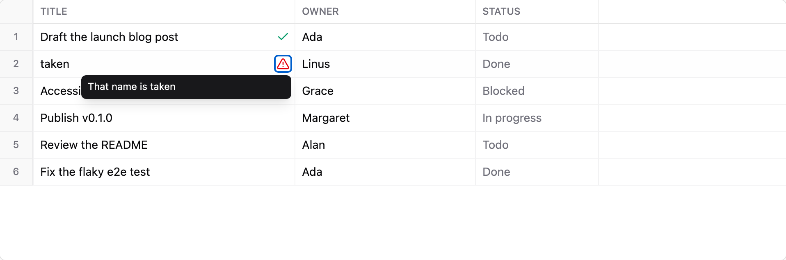

# @codemancers/sheets

A spreadsheet-style data grid for React. It's built on [TanStack Table](https://tanstack.com/table/v8) and comes in two layers: headless hooks that add in-place editing, and ready-made components styled with Tailwind CSS v4.



- **Spreadsheet layout:** row numbers, a sticky header, resizable columns, grouped headers, a sticky add-row footer, and loading and empty states.
- **In-place editing:** click a cell, type, then Enter to save or Escape to cancel. Each cell shows its own status: unsaved, saving, saved or refused.
- **Saving per row:** edits to one row can be batched into a single request. If the server refuses a field, the error appears on that field's cell.
- **Validation** with any [Standard Schema](https://standardschema.dev) library (zod, Valibot, ArkType and others).
- **Plain TanStack Table underneath:** columns are TanStack `ColumnDef`s, and `useSheet` takes every `useReactTable` option.
- **Accessible:** screen readers see a real table, and sorting, resizing and editing all work from the keyboard.
- **Adaptable:** theme tokens, translatable labels, and right-to-left layouts.

## Contents

- [Install](#install)
- [Quick start](#quick-start)
- [Columns and cells](#columns-and-cells)
- [Sorting and filtering](#sorting-and-filtering)
- [Editing and saving](#editing-and-saving)
- [Layout and states](#layout-and-states)
- [Customising](#customising)
- [Headless use](#headless-use)
- [Accessibility](#accessibility)
- [Next.js](#nextjs)
- [Limitations](#limitations)
- [API reference](#api-reference)

## Install

You need React 18.2+ or 19 and TanStack Table v8. The components also need Tailwind CSS v4. The hooks alone don't.

```sh
pnpm add @codemancers/sheets @tanstack/react-table
```

Add the package's stylesheet after Tailwind, in the CSS file where you import Tailwind:

```css
@import 'tailwindcss';
@import '@codemancers/sheets/styles.css';
```

This adds the components' classes and theme tokens to your Tailwind build.

**Dark mode.** The components use `dark:` classes, and by default Tailwind's `dark:` follows the operating system. If your app has no dark mode, or switches it with a class, add this line; otherwise the sheet turns dark on its own for people whose OS is set to dark:

```css
@custom-variant dark (&:where(.dark, .dark *));
```

## Quick start

```tsx
'use client';

import { createColumnHelper } from '@tanstack/react-table';
import { useSheet } from '@codemancers/sheets';
import { Sheet, SheetTextCell } from '@codemancers/sheets/ui';

type Task = { id: string; title: string; status: string; owner: string };

const task = createColumnHelper<Task>();

const columns = [
  task.accessor('title', { header: 'Title', size: 280 }),
  task.accessor('status', {
    header: 'Status',
    cell: ({ getValue }) => <SheetTextCell muted>{getValue()}</SheetTextCell>,
  }),
  task.accessor('owner', { header: 'Owner' }),
];

export function TaskSheet({ tasks }: { tasks: Task[] }) {
  const sheet = useSheet({
    columns,
    data: tasks,
    getRowId: (task) => task.id,
  });

  return (
    <div style={{ height: 480 }}>
      <Sheet instance={sheet} emptyState="No tasks yet." />
    </div>
  );
}
```

How the pieces fit together:

- `useSheet` is TanStack's `useReactTable` with a sheet's defaults. It returns `{ table, cellStatus, rowChanges }`.
- `<Sheet>` fills its parent and scrolls inside it, so give the parent a height.
- `getRowId` sets each row's id. Always set it to your data's own id: editing state, highlighting and React keys all use the row id. TanStack's default is the row's position, which changes when rows are sorted or added.

## Columns and cells

Columns are plain TanStack column definitions, and TanStack's [column docs](https://tanstack.com/table/v8/docs/guide/column-defs) apply as they are. `meta`, `size`/`minSize`/`maxSize`, `enableSorting`, `sortingFn`, `filterFn`, `header` functions and group columns all work. Define columns outside the component, or memoise them, as TanStack recommends.

A column without a `cell` renders its value as padded text. For anything else, render one of the built-in cells or your own markup:

| Cell                    | Use it for                                                                           | Main props                                                                              |
| ----------------------- | ------------------------------------------------------------------------------------ | --------------------------------------------------------------------------------------- |
| `SheetTextCell`         | Text. This is also the default for plain values.                                     | `muted`                                                                                 |
| `SheetLinkCell`         | A link                                                                               | `href`, `LinkComponent`                                                                 |
| `SheetPrimaryCell`      | The row's name, with "open" and "details page" actions that appear on hover or focus | `href`, `onOpen`, `detailHref`, `openLabel`, `detailLabel`, `LinkComponent`, `editable` |
| `SheetEditableTextCell` | Text you click to edit                                                               | `value`, `onCommit`, `schema`, `stage`, `placeholder`, `autoFocus`, `onCancel`          |
| `SheetActionsCell`      | A row of buttons or menus                                                            | `children`                                                                              |

`SheetPrimaryCell` renders the name in one of three ways:

- **With `href`:** a link. With `onOpen` as well, a plain click opens the row in place (a side panel, a dialog) and a modified click still opens `href`.
- **With `onOpen` only:** a button that opens the row.
- **With neither:** plain text.

The panel icon appears only when `onOpen` is set, and the details-page icon only when `detailHref` is set. Pass `editable` to rename in place instead (see [Editing and saving](#editing-and-saving)).

```tsx
task.accessor('title', {
  header: 'Title',
  cell: ({ row }) => (
    <SheetPrimaryCell href={`/tasks?open=${row.id}`} onOpen={() => openPanel(row.id)} detailHref={`/tasks/${row.id}`} openLabel="Open task" detailLabel="Open task page">
      {row.original.title}
    </SheetPrimaryCell>
  ),
});
```

**Grouped headers** span their columns:

```tsx
const columns = [
  task.group({
    id: 'task',
    header: 'Task',
    columns: [task.accessor('title', { header: 'Title' }), task.accessor('status', { header: 'Status' })],
  }),
  task.accessor('owner', { header: () => <abbr title="Assigned to">Owner</abbr> }),
];
```

## Sorting and filtering

Sorting and filtering run in the browser by default. Any column with an accessor is sortable through its header button; turn that off with `enableSorting: false` on the column or on the table. To filter, use TanStack's column and global filter APIs (`column.setFilterValue`, `table.setGlobalFilter`) from your own controls.

**Server-side data.** Set TanStack's manual flags and control the state. The sheet then reports the sort, and your data layer applies it:

```tsx
const [sorting, setSorting] = useState<SortingState>([]);
const { data = [] } = useTasksQuery({ sorting }); // your fetching

const sheet = useSheet({
  columns,
  data,
  getRowId: (task) => task.id,
  manualSorting: true,
  state: { sorting },
  onSortingChange: setSorting,
});
```

Any state you don't control (column widths, visibility, order) is managed by the table. Change handlers receive TanStack updaters, so a React state setter works as it is.

## Editing and saving

Editable cells validate a value, hand it on, and show the outcome on the cell itself rather than in a toast. A toast can't say _which_ cell it means.

### Saving per row (recommended)

`useRowChanges` makes the row, not the cell, the unit you save. Cells hand it their committed values, and it calls your `onSubmitRow` with everything changed in that row:

```tsx
import { useCellStatus, useRowChanges, useSheet } from '@codemancers/sheets';
import { Sheet, SheetEditableTextCell, SheetPrimaryCell } from '@codemancers/sheets/ui';

const columns = [
  task.accessor('title', {
    header: 'Title',
    cell: ({ row }) => <SheetPrimaryCell editable={{ value: row.original.title, schema: titleSchema }}>{row.original.title}</SheetPrimaryCell>,
  }),
  task.accessor('owner', {
    header: 'Owner',
    cell: ({ row }) => <SheetEditableTextCell value={row.original.owner} stage />,
  }),
];

function TaskSheet({ tasks }: { tasks: Task[] }) {
  const cellStatus = useCellStatus();
  const rowChanges = useRowChanges({
    cellStatus,
    flush: { debounce: 600 },
    onSubmitRow: async (rowId, changes) => {
      const response = await fetch(`/api/tasks/${rowId}`, {
        method: 'PATCH',
        body: JSON.stringify(changes),
      });
      // Nothing means success; { error, fieldErrors } means refused.
      if (!response.ok) return response.json();
    },
  });
  const sheet = useSheet({
    columns,
    data: tasks,
    getRowId: (task) => task.id,
    cellStatus,
    rowChanges,
  });

  return <Sheet instance={sheet} />;
}
```

- `SheetPrimaryCell` stages automatically when the sheet has a row buffer.
- `SheetEditableTextCell` stages only with `stage`. That keeps it usable for a new row, where saving means _creating_ the record rather than updating it.

**Flush policies:**

| `flush`                 | Behaviour                                                                                                                   |
| ----------------------- | --------------------------------------------------------------------------------------------------------------------------- |
| `'immediate'` (default) | Sends every edit as soon as it's committed: one request per field.                                                          |
| `{ debounce: ms }`      | Waits for a pause in editing, then sends everything staged for that row as one request. Edits made during the wait join it. |

**What `onSubmitRow` returns:**

- **Success:** nothing (or `undefined`).
- **Refused:** `{ error, fieldErrors }`. `fieldErrors` maps column ids to messages, for example `{ title: ['That name is taken'] }`, and each message appears on its column's cell. If the server can't attribute the error, `error` appears on every cell that was sent.
- **Network failure:** throw. The cells then show `transportErrorMessage`, which defaults to "Could not save. Check your connection.".

**Cell statuses:**

| Status  | Shown as                     | Meaning                                                                                                                             |
| ------- | ---------------------------- | ----------------------------------------------------------------------------------------------------------------------------------- |
| Unsaved | A dot                        | Not saved yet: either a debounce is still waiting, or the server refused another field in the same request. Stays until it's saved. |
| Saving  | A spinner                    | The request is in flight.                                                                                                           |
| Saved   | A tick                       | Written. Clears itself after 2 seconds.                                                                                             |
| Refused | A warning icon and a tooltip | Not saved. Stays until the user acts on the cell, and is announced to screen readers.                                               |

**Behaviour you can rely on:**

- **A refused value stays on screen,** so the error has something to explain. Reopening the editor keeps the text, so a typo gets fixed rather than retyped.
- **Retrying works:** pressing Enter on the unchanged text sends it again. Editing back to the saved value, or pressing Escape, drops the refused value.
- **What a cell displays,** in order of priority: its staged value, then its refused value, then the value from your data. A refetch that lands mid-edit can't overwrite what the user just typed.
- **One request per row at a time.** A save waits for the one in flight instead of racing it.
- **A refused batch stays unsaved in full.** When the server refuses one field of a batch, it saved none of them. The other cells go back to "unsaved" rather than showing a tick.
- **Leaving the page:** whatever is queued is sent on unmount, but a cleanup can't wait for the response. If someone can navigate away mid-edit, check `rowChanges.hasStagedChanges()` and call `rowChanges.flushAll()` in your navigation guard.

### Saving per cell

Without `rowChanges`, each editable cell calls its own `onCommit`. You then perform the write and report the result yourself:

```tsx
const { cellStatus } = sheet; // the same useCellStatus() instance you passed in

async function rename(rowId: string, title: string) {
  try {
    await saveTitle(rowId, title);
    cellStatus?.setCellSaved(rowId, 'title');
  } catch (error) {
    cellStatus?.rejectCellValue(rowId, 'title', 'Could not save', title);
  }
}
```

Most apps should use `useRowChanges` with `flush: 'immediate'`, which does all of this for you.

### Validation

Give an editable cell a `schema` and the value is checked before it's staged or committed. A failure appears on the cell with the schema's first message. Any [Standard Schema](https://standardschema.dev) works, including zod 3.24+, Valibot, ArkType and Yup; async schemas are awaited:

```tsx
import { z } from 'zod';

const titleSchema = z.string().trim().min(1, 'Title is required');

<SheetPrimaryCell editable={{ value: row.original.title, schema: titleSchema }}>{row.original.title}</SheetPrimaryCell>;
```

A value the schema rejects never enters the row buffer, so the rest of the row still saves without it. Sharing schemas with your API means both sides reject a value with the same message. The server still decides what only it can know, such as uniqueness, and reports that through `fieldErrors`.

### Your own editable cells

Inside a `Sheet`, a cell can find its row, its column and the editing state through context. That means any cell type can join the same saving and status model. Values don't have to be strings:

```tsx
import { useSheetCellEditing } from '@codemancers/sheets';

function PriorityCell({ value }: { value: number }) {
  const cell = useSheetCellEditing();
  const shown = Number(cell.stagedValue ?? cell.refusedValue ?? value);

  return (
    <select aria-label={cell.label} value={shown} onChange={(event) => cell.stage(Number(event.target.value))} className="w-full bg-transparent px-2">
      <option value={1}>High</option>
      <option value={2}>Medium</option>
      <option value={3}>Low</option>
    </select>
  );
}
```

- `useSheetCellEditing(schema?)` gives you:
  - `stage`, `canStage`, `stagedValue` and `refusedValue`
  - `accepts`, which runs the schema and reports a failure on the cell
  - `abandon` and `clearOnEditStart`
  - `label`, the column's header, for naming your editor
- `useInlineEdit` handles text-style editors: Enter, Escape, saving on blur, IME input, and returning focus to the cell.
- Report outcomes through `cellStatus`, and `SheetCell` draws the icons.

## Layout and states

`<Sheet>` fills its parent (`h-full w-full`) and scrolls inside it. The header and the add-row footer stay pinned while the rows scroll. Give the parent a height:

```tsx
// Fill the rest of a full-height page
<div className="flex h-svh flex-col">
  <header>…</header>
  <div className="min-h-0 flex-1">
    <Sheet instance={sheet} />
  </div>
</div>
```

Column widths come from `size` (TanStack's default is 150px). After the last column, an empty filler column takes up the remaining width. `rowHeight` sets the minimum row height (default 32px).

| Prop                     | What it does                                                                                                                       |
| ------------------------ | ---------------------------------------------------------------------------------------------------------------------------------- |
| `isLoading`              | Shows placeholder rows inside the same frame and marks the rows busy for assistive tech. `loadingState` replaces the placeholders. |
| `emptyState`             | Content for a row that spans the columns when there's no data. Defaults to the `empty` label.                                      |
| `onAddRow`               | Shows the sticky add-row footer. `addRowDisabled` disables its button.                                                             |
| `highlightedRowId`       | Highlights a row and scrolls it into view. Clear it after a moment to fade the highlight.                                          |
| `rowHeight`, `className` | The minimum row height, and extra classes for the scroll container.                                                                |

```tsx
const [highlightedRowId, setHighlightedRowId] = useState<string>();

useEffect(() => {
  if (!highlightedRowId) return;
  const timer = setTimeout(() => setHighlightedRowId(undefined), 1500);
  return () => clearTimeout(timer);
}, [highlightedRowId]);

<Sheet instance={sheet} onAddRow={() => setHighlightedRowId(addTask().id)} highlightedRowId={highlightedRowId} />;
```

## Customising

### Colours

Every colour comes from a `--color-sheet-*` theme token, and each token has a `-dark` partner used under `dark:`. The defaults are Tailwind's zinc and blue palettes. To restyle, redefine tokens after the import:

```css
@import 'tailwindcss';
@import '@codemancers/sheets/styles.css';

@theme {
  --color-sheet-link: var(--color-indigo-600);
  --color-sheet-link-dark: var(--color-indigo-400);
}
```

To follow your design system's CSS variables, such as shadcn's, use `@theme inline`. The values then resolve wherever they're used, so variables that change under your dark-mode class keep working:

```css
@theme inline {
  --color-sheet-bg: var(--background);
  --color-sheet-bg-dark: var(--background);
  --color-sheet-fg: var(--foreground);
  --color-sheet-fg-dark: var(--foreground);
  --color-sheet-muted: var(--muted-foreground);
  --color-sheet-muted-dark: var(--muted-foreground);
  --color-sheet-link: var(--primary);
  --color-sheet-link-dark: var(--primary);
  --color-sheet-error: var(--destructive);
  --color-sheet-error-dark: var(--destructive);
}
```

| Token (each with a `-dark` partner, except `accent` and `tooltip-fg`) | Used for                                                              |
| --------------------------------------------------------------------- | --------------------------------------------------------------------- |
| `sheet-bg`, `sheet-fg`                                                | Background and text. Borders and hover tints are `fg` at low opacity. |
| `sheet-muted`, `sheet-faint`                                          | Secondary text, and placeholders                                      |
| `sheet-raised`                                                        | The add-row footer on hover                                           |
| `sheet-skeleton`                                                      | Loading placeholders                                                  |
| `sheet-tooltip`, `sheet-tooltip-fg`                                   | The error tooltip                                                     |
| `sheet-link`, `sheet-link-hover`                                      | Links                                                                 |
| `sheet-accent`                                                        | The column resize handle while it's dragged or focused                |
| `sheet-error`, `sheet-success`, `sheet-warning`                       | The refused, saved and unsaved status icons                           |
| `sheet-highlight`                                                     | The highlighted row                                                   |

### Text and translation

`<Sheet labels={…}>` replaces any of the text the sheet renders itself:

| Label                        | Default                      | Used for                                     |
| ---------------------------- | ---------------------------- | -------------------------------------------- |
| `rowNumber`                  | `Row`                        | The name of the row-number column            |
| `sort(column)`               | `Sort {column}`              | Header sort buttons                          |
| `resize(column)`             | `Resize {column}`            | Resize handles                               |
| `width(pixels)`              | `{pixels} pixels`            | A resize handle's current width, read out    |
| `filtered`                   | `(filtered)`                 | Announced on a filtered column               |
| `unsaved`, `saving`, `saved` | `Unsaved`, `Saving`, `Saved` | Cell statuses, announced                     |
| `empty`                      | `No data.`                   | The empty state, when `emptyState` isn't set |
| `addRow`                     | `Add row`                    | The add-row button                           |

Cells and hooks take their own text props: `openLabel` and `detailLabel` on `SheetPrimaryCell`, `placeholder` on editable cells, and `transportErrorMessage` on `useRowChanges`.

### Right-to-left

Under `dir="rtl"` the layout mirrors. Pass TanStack's `columnResizeDirection` so that dragging and the arrow keys resize the right way:

```tsx
const sheet = useSheet({ columns, data, columnResizeDirection: 'rtl' });
```

## Headless use

`useSheet` returns a standard TanStack `table`, so you can render your own markup and still use the editing hooks:

```tsx
import { flexRender } from '@tanstack/react-table';
import { useSheet } from '@codemancers/sheets';

const { table } = useSheet({ columns, data, getRowId: (task) => task.id });

<table>
  <thead>
    {table.getHeaderGroups().map((group) => (
      <tr key={group.id}>
        {group.headers.map((header) => (
          <th key={header.id} colSpan={header.colSpan}>
            {header.isPlaceholder ? null : flexRender(header.column.columnDef.header, header.getContext())}
          </th>
        ))}
      </tr>
    ))}
  </thead>
  <tbody>
    {table.getRowModel().rows.map((row) => (
      <tr key={row.id}>
        {row.getVisibleCells().map((cell) => (
          <td key={cell.id}>{flexRender(cell.column.columnDef.cell, cell.getContext())}</td>
        ))}
      </tr>
    ))}
  </tbody>
</table>;
```

`useCellStatus`, `useRowChanges` and `useInlineEdit` don't depend on the components. Wrap a cell in `SheetCellProvider` to give it the same context `<Sheet>` provides.

## Accessibility

- **Table semantics:** the sheet is a table to assistive tech. Headers carry `aria-sort`, and the row-number column is named. Loading rows are marked busy, and the placeholder rows are hidden.
- **Keyboard:**
  - Tab reaches the sort buttons, resize handles, cells and row actions. Row actions appear on focus as well as hover.
  - Enter or Space opens an editable cell. Enter saves, Escape cancels, and both return focus to the cell. Tab saves and moves on to the next cell.
  - On a focused resize handle, the arrow keys resize the column (Shift for bigger steps), and a double-click resets it.
- **Screen readers:** editors are named after their column. Saving statuses are announced, and refused values are announced as alerts.
- **Testing:** the playground is scanned with axe in CI, and any violation fails the build.

Not yet supported: moving between cells with the arrow keys (`role="grid"`).

## Next.js

- Every module that uses hooks or context is marked `'use client'`. Render the sheet from a client component, and pass server data down as props.
- Import `@codemancers/sheets/styles.css` in the global stylesheet where you import Tailwind.
- To use Next's router for links, pass `LinkComponent={Link}`. To stop Next prefetching every row's link, wrap it: `LinkComponent={(props) => <Link prefetch={false} {...props} />}`.

## Limitations

- **No virtualisation yet.** Every row is rendered. Hundreds to a few thousand rows are fine; beyond that, render your own body with `@tanstack/react-virtual` through the headless API.
- **No column pinning,** and no arrow-key navigation between cells.
- **Text editors only.** The built-in editors are for text; other types need your own cells (see [Your own editable cells](#your-own-editable-cells)).
- **TanStack Table v8 only.**
- **The error tooltip** on the very last row of a completely full sheet can extend past the bottom edge, and the sheet scrolls to show it.

## API reference

### `@codemancers/sheets`

| Export                                     | What it is                                                                                                                                                                                        |
| ------------------------------------------ | ------------------------------------------------------------------------------------------------------------------------------------------------------------------------------------------------- |
| `useSheet(options)`                        | `useReactTable` plus `cellStatus` and `rowChanges`. Returns `{ table, cellStatus, rowChanges }`.                                                                                                  |
| `useCellStatus()`                          | Per-cell outcomes: `setCellSaved`, `rejectCellValue`, `rejectFieldErrors`, `clearCellStatus`, `abandonCellValueChange`, `setCellDirty`, `setCellSaving`, `statuses`, `rejectedCellValue`.         |
| `useRowChanges(options)`                   | The per-row save buffer. Options: `onSubmitRow`, `cellStatus`, `flush`, `transportErrorMessage`. Returns `stageCellValue`, `discardCellValue`, `stagedCellValue`, `hasStagedChanges`, `flushAll`. |
| `useInlineEdit(options)`                   | Edit-in-place state for a text editor: `isEditing`, `beginEdit`, `commit`, `cancel`, `inputProps`, `triggerRef`.                                                                                  |
| `useSheetCellEditing(schema?)`             | The editing context for a cell, for building your own (see above).                                                                                                                                |
| `SheetCellProvider`, `useSheetCellScope()` | The row, column and editing context a cell reads.                                                                                                                                                 |
| Types                                      | `SheetInstance`, `UseSheetOptions`, `CellStatus`, `CellStatusState`, `RowChanges`, `RowChangesState`, `RowSubmitResult`, `RowFlushPolicy`, `SheetCellValidator`, `StandardSchemaV1`.              |

### `@codemancers/sheets/ui`

| Export                                                                                                                     | What it is                                                                                   |
| -------------------------------------------------------------------------------------------------------------------------- | -------------------------------------------------------------------------------------------- |
| `Sheet`                                                                                                                    | The grid. Props: [Layout and states](#layout-and-states) and `labels`.                       |
| `SheetTextCell`, `SheetLinkCell`, `SheetPrimaryCell`, `SheetEditableTextCell`, `SheetActionsCell`                          | The built-in cells.                                                                          |
| `SheetLabels`, `defaultSheetLabels`                                                                                        | The label type and the English defaults.                                                     |
| `SheetHeader`, `SheetRow`, `SheetCell`, `SheetRowNumber`, `SheetEmpty`, `SheetLoading`, `SheetAddRow`, `SheetSpacerColumn` | The pieces `Sheet` is built from, for composing your own. They must render inside a `Sheet`. |

### `@codemancers/sheets/styles.css`

The Tailwind v4 entry: it registers the components' classes and the theme tokens.

## License

[MIT](LICENSE)
